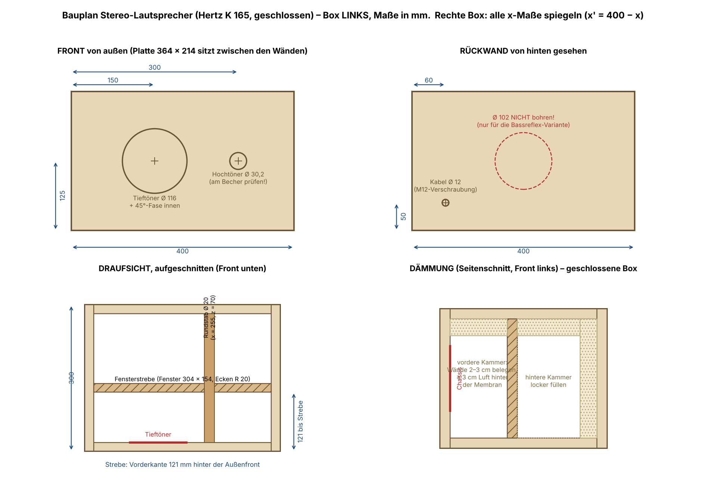

# Bauanleitung – Schritt für Schritt

Gebaut werden **2 geschlossene Boxen** (Stereo-Paar, spiegelbildlich) aus Buche 18 mm,
40 × 30 × 25 cm, für das **Hertz K 165 Fan Edition**. Die Maße stehen im **[Bauplan](bauplan.png)**,
die 3D-Ansicht in der [vorschau.png](vorschau.png). Rechne mit einem Wochenende plus Öl-Trockenzeit.

## 0. Das brauchst du

**Material** (für beide Boxen):

- [ ] Buche-Multiplex 18 mm, ca. 1,2 m² – Zuschnitt siehe Schritt 1
- [ ] Rundstab Buche Ø 20 mm, mind. 60 cm (2 × 264 mm)
- [ ] Holzleim wasserfest (D3), Kartusche Maler-Acryl
- [ ] Spax 4 × 50 (Gehäuse, ~30 Stk.) und 4 × 25 (Chassis, 16 Stk.), 3-mm-Vorbohrer, Senker
- [ ] 2 × Kabelverschraubung M12 + Lautsprecherkabel 2 × 1,5 mm²
- [x] **Dämmwolle – hast du schon** (2 Boxen brauchen zusammen grob 150–200 g)
- [ ] Dichtband (Moosgummi, 10 × 3 mm) für die Chassis
- [ ] Hartwachsöl oder Leinölfirnis, Schleifpapier 120/180/240
- [ ] 8 Filz- oder Gummifüße
- [x] Hertz K 165 Fan Edition (Tieftöner, Hochtöner, Weichen)

**Werkzeug:** Stichsäge (feines Holzblatt), Bohrmaschine, Forstnerbohrer 20 und 30 mm,
12-mm-Holzbohrer, Raspel/Schleifrolle, 4–6 Schraubzwingen, Zollstock + Zirkel, Bleistift.

## 1. Zuschnitt besorgen

Im Baumarkt oder Holzhandel sägen lassen (genauer als von Hand), **Kanten rechtwinklig**:

| Stück | Anzahl | Maß (mm) |
|---|---|---|
| Deckel / Boden | 4 | 400 × 300 |
| Seitenwände | 4 | 300 × 214 |
| Front / Rückwand / Strebe | 6 | 364 × 214 |
| Rundstab Ø 20 | 2 | 264 lang |

Zu Hause alle Teile mit Bleistift beschriften: **L** oder **R** plus Name (z. B. „L-Front“).

## 2. Anzeichnen

Alle Positionen aus dem [Bauplan](bauplan.png) übertragen. **Wichtig:** Die Maße gelten für die
**linke** Box – bei der rechten Box alle x-Maße spiegeln (x′ = 400 − x), damit die Hochtöner
nachher **innen** sitzen. Bohrungszentren körnen (Nagel ansetzen, leicht schlagen).

## 3. Sägen und Bohren (vor dem Verleimen!)

1. **Tieftöner-Ausschnitt Ø 116** (2 × Front): Loch anzeichnen, innen ein 10-mm-Startloch bohren,
   mit der Stichsäge knapp **innerhalb** der Linie sägen, mit Raspel bis zur Linie. Dann die
   **45°-Fase** auf der **Innenseite**: mit Raspel oder Fräser die hintere Lochkante rundum ca.
   10 mm brechen, damit die Membran nach hinten frei atmet.
   ⚠️ Vorher die Schablone aus dem K-165-Karton auflegen – das Chassis muss stramm, aber ohne
   Gewalt hineingehen.
2. **Hochtöner Ø 30,2** (2 × Front): Forstner 30 mm bohren, mit Schleifpapier auf Maß weiten.
   ⚠️ Vorher am mitgelieferten Einbaubecher messen.
3. **Kabelloch Ø 12** (2 × Rückwand): von außen bohren, Position siehe Bauplan (gespiegelt!).
   **Kein 102-mm-Loch bohren** – die Box bleibt geschlossen.
4. **Strebenfenster 304 × 154** (2 × Strebe): In jede Ecke ein 40-mm-Loch (Forstner oder
   Lochsäge), dazwischen mit der Stichsäge gerade sägen, Kanten mit Raspel runden.
5. **Stab-Markierung**: Position des Rundstabs (x = 255, z = 70, gespiegelt für R) auf den
   **Innenseiten** von Front und Rückwand anzeichnen.

## 4. Probelauf ohne Leim

Jede Box einmal trocken zusammenstellen (Zwingen): Boden, Seiten, Front, Rückwand, Strebe.
Prüfen: Alles bündig? Chassis passt? Strebe sitzt 121 mm hinter der Front? Erst weiter, wenn ja.

## 5. Verleimen

Immer: Leim auf beide Flächen, zusammenpressen (Zwingen oder vorgebohrte Spax 4 × 50,
mind. 3 cm vom Rand), austretenden Leim feucht abwischen, **pro Fuge 30–60 min** gepresst lassen.

1. **Strebe auf den Boden** leimen: Vorderkante 121 mm hinter der Boden-Vorderkante, seitlich 18 mm Abstand (dort kommen die Seiten hin).
2. **Beide Seiten** an Boden + Strebe.
3. **Rundstab an die Rückwand**: Stabende auf die Markierung leimen und von außen mit einer Spax 4 × 50 durch die Rückwand sichern (vorbohren). **Kabelverschraubung M12** jetzt einschrauben.
4. **Rückwand** einsetzen (an Boden, Seiten, Strebe).
5. **Deckel** auflegen und verleimen – auch auf Strebe und Stab… **Stopp: erst Schritt 6 lesen!** Wer innen bequem arbeiten will, lässt den Deckel noch ab und leimt ihn als letztes Holzteil vor der Front auf.

## 6. Innen abdichten

Alle Innenfugen mit **Acryl** ausziehen (Finger glätten). Geschlossene Boxen leben von
Luftdichtheit – jede undichte Fuge kostet Bass und zischt.

## 7. Weiche und Verkabelung

1. Die **Hertz-Weiche** auf den Boden schrauben: hinten, nahe der Kabelverschraubung (nicht nur kleben – sie darf nie klappern).
2. Lautsprecherkabel durch die M12 führen, Verschraubung festziehen (zugdicht = luftdicht).
3. Kabel an die Weiche, von dort je ein Paar zur Tieftöner- und zur Hochtöner-Öffnung, **15 cm Überlänge** lassen. Kabel alle 10 cm mit Klebepads oder Tackerschlaufe festlegen.
4. **Polung notieren**: plus = markierte Ader. Beide Boxen exakt gleich!

## 8. Dämmen (dein Dämmmaterial)

Wie im Bauplan rechts unten:

- **Hintere Kammer** (zwischen Strebe und Rückwand): Wände mit 2–3 cm belegen (Sprühkleber
  oder Tacker), den Rest **locker** füllen – zusammengedrückt wirkt Wolle nicht.
- **Vordere Kammer**: Deckel, Boden und beide Seitenflächen mit 2–3 cm belegen.
  **Mindestens 3 cm Luft hinter der Tieftöner-Membran freihalten.**
- Nichts darf die Membranrückseite oder die Weiche berühren können.

## 9. Front aufleimen

Front einsetzen (Stabende bekommt Leim und drückt gegen die Front), verpressen, Fuge innen
soweit erreichbar durch die Chassis-Öffnungen mit Acryl nachziehen.

## 10. Schleifen und Ölen

Kanten mit R 2–3 mm brechen, 120 → 180 → 240 schleifen, entstauben. 2–3 × dünn ölen
(zwischendurch trocknen lassen, mit 240 zwischenschleifen). Buche wird warm honigfarben.
Füße unten ankleben/anschrauben.

## 11. Chassis einbauen

1. **Dichtband** auf die Auflageringe von Tief- und Hochtöner kleben.
2. Kabel anschließen (Polung!), Chassis einsetzen, mit Spax 4 × 25 **über Kreuz** anziehen (vorbohren, nicht überdrehen).
3. **Dichtheitstest:** Tieftöner-Membran langsam und sanft mit beiden Händen eindrücken und halten – der Gegendruck muss stehen bleiben und die Membran nur ganz langsam zurückkriechen. Fällt der Druck sofort ab: Leck suchen (Fugen, M12, Chassisrand).

## 12. Aufstellen und hören

Hochtöner auf Ohrhöhe und **innen** (zur Mitte), Boxen leicht auf den Hörplatz eingedreht,
Wandabstand unkritisch (geschlossene Box!). Erst leise testen: Kommt der Bass aus beiden
Boxen gleich stark? Falls dünn/leise im Bass → eine Box ist verpolt.

---

**Später auf Bassreflex umrüsten?** (nur sinnvoll mit einem Hifi-Tieftöner, Qts ≤ 0,45):
In `lautsprecherbox.scad` `bauart = "bassreflex"` setzen, Ø 102 mittig in die Rückwand bohren,
die Teile `rohr_aussen/muffe/innen.stl` drucken und einbauen – Details in der [README](README.md).
