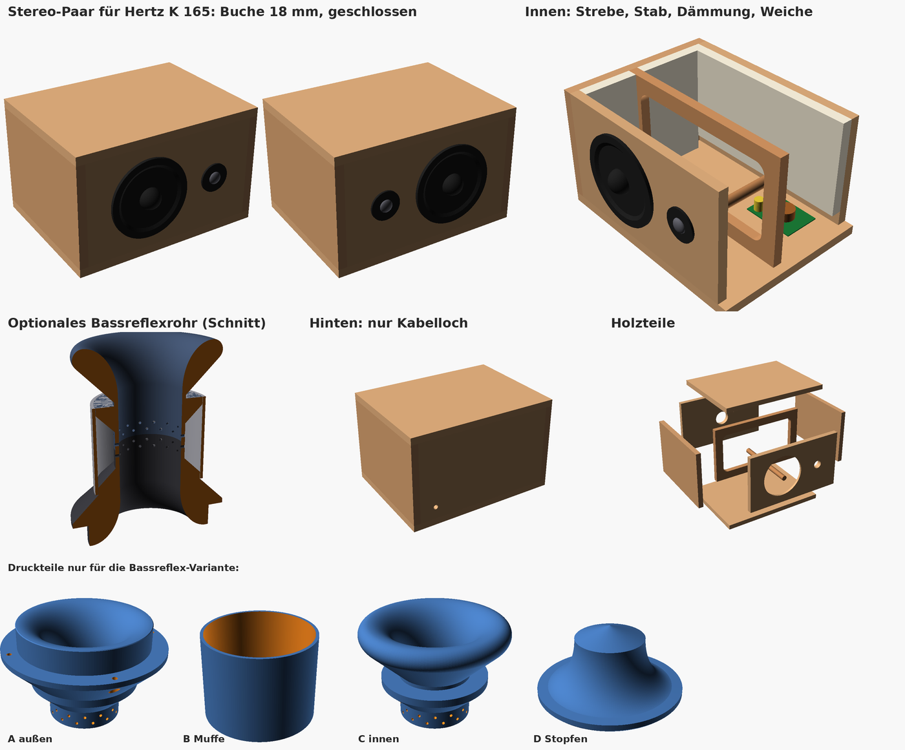
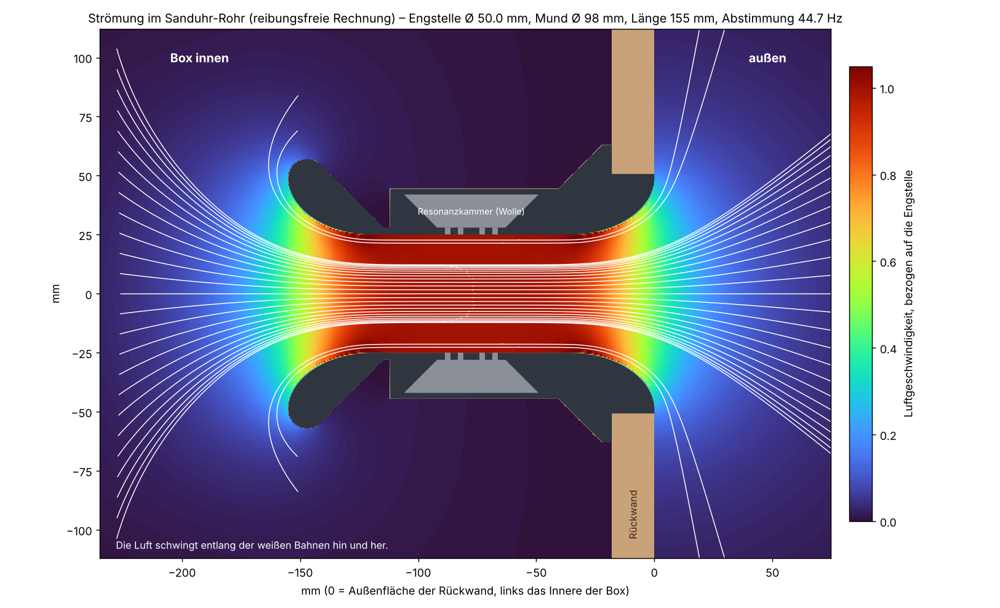

# Lautsprecherboxen aus Buche – Stereo-Paar (2 Stück)

Zwei gleiche Boxen, spiegelbildlich gebaut, mit einem Innenleben, das auf freien Luftfluss
und wenig Eigenresonanz ausgelegt ist.

## Kurzfassung

| | je Box |
|---|---|
| **Anzahl** | **2 Boxen**, spiegelbildlich: Hochtöner jeweils **innen** (zur Mitte) |
| **Holz** | **Buche 18 mm**, am besten als **Buche-Multiplex** (siehe unten) |
| **Außenmaße** | 40 cm breit × 30 cm tief × 25 cm hoch |
| **Innenvolumen** | 20,6 L brutto, **ca. 18,5 L netto** |
| **Chassis** | **Hertz K 165 Fan Edition**: Tieftöner 165 mm (Aufnahme 116, Tiefe 45 mm) + 24-mm-Hochtöner, 4 Ω, 50 W RMS / 300 W Spitze, 92 dB, Weiche (6 dB/Okt.) liegt bei |
| **Betrieb mit dem K 165** | **geschlossen** – Rückwand ohne Rohrloch (`bauart = "geschlossen"`, Standard) |
| **Bauanleitung** | **Schritt für Schritt: [BAUPLAN.md](BAUPLAN.md)** mit bemaßter Zeichnung [bauplan.png](bauplan.png) |
| **Bassreflex** | **Sanduhr-Rohr** mittig in der Rückwand: Engstelle Ø 50, Münder Ø 98, außen bündig, **44,7 Hz** (Strömungsrechnung) |
| **Deckel** | geschlossen, ohne Ausschnitt |
| **Rückwand** | Kabeldurchführung Ø 12 mm (für eine M12-Kabelverschraubung) |
| **Innen** | Fensterstrebe, Rundstab Front↔Rückwand, Fase hinter dem Tieftöner, Dämmung |
| **Gewicht** | ca. 7 kg Holz |

## Buche – gute Wahl, aber in der richtigen Form

Buche ist hart, schwer und sehr steif, also ein ausgezeichnetes Boxenmaterial (steifer als MDF).
Gut ist eine Boxenwand, wenn sie selbst möglichst *nicht* mitklingt. Die Steifigkeit der Buche hilft genau dabei.

- **Empfohlen: Buche-Multiplex 18 mm.** Die Platte besteht ganz aus verleimten Buchenschichten. Sie ist sehr steif, verzieht sich nicht und reißt nicht, und die gestreiften Kanten sehen schön aus. Erhältlich im Holzfachhandel oder online mit Zuschnitt.
- **Buche-Leimholz 18 mm** (massiv, Baumarkt) geht auch, aber Buche „arbeitet“ stark. Bei wechselnder Luftfeuchte quillt und schwindet sie quer zur Faser um einige Millimeter auf 40 cm. In einer rundum verleimten Box können dann Fugen reißen, und die Box wird undicht. Wenn du Leimholz nimmst:
  1. **Faserrichtung:** Deckel, Boden und Seiten mit der Faser **von vorne nach hinten**, Front und Rückwand mit der Faser **senkrecht**. So arbeiten fast alle Fugen in dieselbe Richtung, nur die vier kurzen senkrechten Kanten nicht.
  2. Die **Fensterstrebe trotzdem aus Multiplex** sägen. Ein Rahmen aus Massivholz würde gegen die Wände arbeiten.
  3. Das Holz vor dem Bau **1–2 Wochen im Raum lagern** und **innen und außen gleich ölen**.

## Das Innenleben – was es bringt

Die Luft in der Box strömt nicht im Kreis, sie **schwingt** im Takt der Musik hin und her. Alles hier
hat ein Ziel: Hinter der Membran und im Rohr soll die Luft frei schwingen können. Wände und
stehende Wellen sollen dagegen ruhig bleiben.

| Maßnahme | Warum |
|---|---|
| **Fensterstrebe** in der Mitte (121 mm hinter der Front), Stege 30 mm, Fensterecken R 20 | Verbindet Deckel, Boden und beide Seiten und halbiert ihre freie Fläche, sodass die Wände kaum mitschwingen. Sie ist zu **~60 % offen**, und die runden Ecken lassen die Luft frei durch, ohne Pfeifen. |
| **Rundstab Buche Ø 20** zwischen Front und Rückwand | Koppelt die beiden Platten, die die Strebe nicht erreicht. Er sitzt neben dem Tieftöner und läuft durch das Fenster der Strebe. |
| **45°-Fase hinter dem Tieftöner-Ausschnitt** (10 mm) | 18 mm Holz hinter der Membran wirken wie ein kurzer Tunnel. Die Fase lässt die Rückseite der Membran frei „atmen“, das gibt weniger Verwirbelung und klarere Mitten. |
| **Sanduhr-Rohr mit Iso-KC-Trichtern** | Im Rohr strömt die Luft am schnellsten, an scharfen Kanten reißt sie ab – das hört man als Schnaufen. Die Trichterkontur ist so gerechnet, dass die Ablöse-Sicherheit an jeder Stelle gleich ist (Details unten). |
| **Resonanzfalle im Rohr** | Jedes Rohr pfeift bei seiner Längsresonanz (hier ≈ 1060 Hz) mit. Um die Rohrmitte sitzt eine mit Wolle bedämpfte Ringkammer, die über 4 Lochreihen angekoppelt ist und genau diese Resonanz schluckt. |
| **Rohr genau in der Mitte der Rückwand** | Die stärksten stehenden Wellen im Inneren (Breite ≈ 471 Hz, Höhe ≈ 801 Hz) haben genau in der Mitte ihren Druckknoten. Dort nimmt das Rohr sie kaum auf und lässt sie nicht nach außen. |
| **Freiraum vor dem Rohrmund** (≥ 50 mm bis zur Strebe) | Das Rohr braucht vor seiner Öffnung mindestens einen Rohrdurchmesser Platz, sonst wird es gebremst und rauscht. |
| **Dämmung**: Rückwand, Deckel und eine Seite mit **2 cm Schafwolle oder Polyesterwatte** auskleiden, um das Rohr herum aussparen | Die Rückwelle des Tieftöners trifft zuerst auf die Rückwand. Ungedämmt käme sie durch die dünne Membran wieder heraus. Die Dämmung schluckt außerdem die Tiefen-Mode (≈ 650 Hz). **Nicht vollstopfen**, eine Bassreflexbox braucht freie Luft. |
| **Absolut luftdicht** | Jede Undichtigkeit pfeift und kostet Bass. |
| **Weiche auf den Boden**, Kabel festlegen | Nichts darf klappern. Die Weiche sitzt nahe am Kabeleingang und weit weg vom Rohrmund. |
| **Hochtöner innen** (spiegelbildliches Paar) | Die Stereomitte wird schärfer, die Stimme steht genau zwischen den Boxen. |

## Zuschnittliste (für beide Boxen, Buche 18 mm)

Deckel und Boden sind durchgehend. Die Seiten stehen dazwischen, Front und Rückwand sitzen zwischen den Seiten.

| Stück | Anzahl | Maß (mm) |
|---|---|---|
| Deckel / Boden | 4 | 400 × 300 |
| Seitenwände | 4 | 300 × 214 |
| Front / Rückwand | 4 | 364 × 214 |
| Fensterstrebe | 2 | 364 × 214, darin ein Fenster 304 × 154 mit Ecken R 20 (Stege 30 mm) |
| Rundstab Buche Ø 20 | 2 | 264 lang |

Zusammen sind das ca. 1,2 m² Platte. Die Fenster der Streben sägst du mit der Stichsäge aus:
in den Ecken ein 40-mm-Loch bohren und dazwischen gerade sägen.

## Bohrbild (Box „links“)

Alle Maße sind Mittelpunkte, von **vorne** gesehen ab der **linken unteren Außenecke**.
**Für die rechte Box** sind alle x-Maße gespiegelt: **x_rechts = 400 − x**.

| Was | Ø | x links | x rechts | z (von unten) | Platte |
|---|---|---|---|---|---|
| Tieftöner | **116 mm** + 45°-Fase innen (10 mm) | 150 | 250 | 125 | Front |
| Hochtöner | 30,2 mm ⚠️ | 300 | 100 | 125 | Front |
| Bassreflexrohr | **102 mm** (Lochsäge) | 200 | 200 | 125 | Rückwand |
| Kabeldurchführung | 12 mm | 340 | 60 | 50 | Rückwand |
| Rundstab | Ø 20 | 255 | 145 | 70 | Front ↔ Rückwand (innen) |
| Fensterstrebe | – | – | – | – | Vorderkante 121 mm hinter der Außenfront |

⚠️ Die 116 mm stammen aus dem Datenblatt („Außen-Ø / Aufnahme × Tiefe: 165/116 × 45 mm“) –
trotzdem vor dem Sägen die Schablone bzw. den Tieftöner selbst auflegen. Die 30,2 mm für den
Hochtöner stammen aus deiner Skizze: am mitgelieferten Einbaubecher nachmessen.
Die Kabeldurchführung liegt bei beiden Boxen auf der **Innenseite** (zur Mitte hin), wo meist der Verstärker steht.

## Die Chassis: Hertz K 165 Fan Edition

Laut Datenblatt: 165-mm-Tieftöner (Aufnahme 116 mm, Einbautiefe 45 mm – passt mit riesigem
Abstand vor die Strebe), 24-mm-Kalotte, 4 Ω, 50 W RMS / 300 W Spitze, 92 dB, 50 Hz–22 kHz,
**Frequenzweiche 6 dB/Okt. liegt getrennt bei**.

### Geschlossen oder Bassreflex? Mit dem K 165: geschlossen.

Das K 165 ist ein Auto-Chassis für den Türeinbau: flach (45 mm), leicht (0,7 kg) und mit hoher
Gesamtgüte gebaut (vergleichbare Hertz-165er liegen bei Qts ≈ 0,6; fürs K 165 selbst nennt Hertz
keine Thiele-Small-Werte). Bassreflex lohnt sich erst ab Qts ≤ etwa 0,45 – mit diesem Chassis
würde das 45-Hz-Rohr kaum Tiefbass bringen und den Oberbass unpräzise machen. **Geschlossen**
passen die 17,8 L dagegen sehr gut: Einbaugüte um 0,75–0,85, untere Grenze um 80–90 Hz,
straffer Bass – tiefer kann dieses Chassis auch mit Rohr nicht sauber.

Darum ist im Modell jetzt `bauart = "geschlossen"` der Standard: Die Rückwand bekommt
**kein** 102-mm-Loch, gedruckt werden muss nichts, und die Dämmung darf die Rückwand komplett
bedecken. Der gesamte Rohr-Abschnitt unten bleibt für die Bassreflex-Variante erhalten
(`bauart = "bassreflex"`), z. B. für einen späteren Hifi-Tieftöner mit Qts ≤ 0,45. Wer dann
beide Varianten vergleichen will, druckt zusätzlich den Stopfen D (`rohr_stopfen.stl`):
mit Filzband umwickelt verschließt er das Rohr, und die Box läuft wieder geschlossen.

## Das Bassreflexrohr: strömungsmechanisch ausgelegt

Das Rohr ist eine **Sanduhr**: Engstelle Ø 50 mm in der Mitte, Münder Ø 98 mm an beiden Enden
(3,8-fache Fläche), Gesamtlänge 155 mm. Es steckt **von innen** in der Rückwand und schließt
außen **bündig** ab – außen ist nur die große Trichteröffnung zu sehen.
Ausgelegt wird es vom Skript `rohr_aerodynamik.py`:

1. **Trichterkontur mit konstanter Ablöse-Sicherheit.** Im Bassreflexrohr strömt die Luft nicht
   gleichmäßig, sie schwingt mit großem Hub hin und her. Ob die Strömung an der Wand „anliegt“
   oder abreißt (→ Wirbel, Schnauf- und Pfeifgeräusche, Verlust an Bass), entscheidet das
   Verhältnis von Luft-Auslenkung zu Wand-Krümmungsradius (Keulegan-Carpenter-Zahl).
   Die Kontur folgt der Bedingung **Krümmungsradius × Querschnittsfläche = konstant**: Am Mund,
   wo die Luft 3,8-fach langsamer ist, darf die Wand stärker gekrümmt sein als an der Engstelle.
   So ist **jede** Stelle des Trichters gleich weit vom Abriss entfernt (KC ≈ 0,56 < 1 bei
   Maximalhub) – kein Punkt der Kontur ist der Schwachpunkt.
2. **Abstimmung aus einer echten Strömungsrechnung.** Die akustische Masse des Rohrs wird als
   rotationssymmetrische Potentialströmung berechnet (Finite-Volumen, ca. 300 000 Zellen,
   inklusive der Mündungsfelder innen in der Box und außen im Freien – das Bild oben ist diese
   Rechnung). Ergebnis: **44,7 Hz** bei 17,8 L netto; eine unabhängige 1D-Kontrolle liefert
   45,8 Hz, und auf halber Gitterweite ändert sich das Ergebnis um < 0,1 Hz.
3. **Eingerollte Lippe innen.** Der innere Mund trägt eine um 135° eingerollte Lippe (Radius
   8 mm): Die Luft, die beim Ansaugen seitlich um den Rand strömt, folgt einer runden Kante
   statt einer scharfen – wie am Hals einer Trompete.
4. **Resonanzfalle gegen das Rohrpfeifen.** Ein 1D-Leitungsmodell legt die erste Längsresonanz
   des Rohrs auf ≈ **1058 Hz**. Genau in der Rohrmitte (Druckmaximum dieser Resonanz, aber
   Schnellemaximum des Bassstroms – dort stört die Öffnung den Bass nicht) sitzen **4 Reihen à
   14 Löcher Ø 2,4 mm**, die in eine mit Wolle gefüllte Ringkammer (135 cm³) führen. Dieser
   bedämpfte Helmholtz-Absorber ist auf 1052 Hz abgestimmt und schluckt das Pfeifen, bevor es
   die Box verlässt. Mitteltonmüll aus dem Inneren wird gleich mit bedämpft.
5. **Geschwindigkeit im Griff.** Bei 60 cm³ Hubvolumen des Tieftöners: 8,6 m/s in der Engstelle,
   aber nur **2,2 m/s am Mund** – unter der üblichen Hörbarkeitsgrenze für Portrauschen.

### Drucken (je Box 1×, also 2× pro Datei)

| Teil | Datei | Drucklage |
|---|---|---|
| A – Außentrichter mit Wandsitz | `rohr_aussen.stl` | Trennebene nach unten (Trichter als Schale nach oben) |
| B – Muffe (Außenwand der Ringkammer) | `rohr_muffe.stl` | stehend |
| C – Innentrichter mit Lippe | `rohr_innen.stl` | Trennebene nach unten |
| D – Stopfen für geschlossenen Betrieb | `rohr_stopfen.stl` | Deckplatte nach unten |

- PETG oder PLA, 0,2 mm Schichten, 3 Perimeter, 15–20 % Infill, **ohne Stützen** (nichts hängt über 45°).
- Alle Teile passen auf ein 180-mm-Bett (größtes Teil Ø 126 mm).

### Zusammenbau des Rohrs

1. Teil A von **innen** durch das 102-mm-Loch der Rückwand stecken (der Zylinder schließt außen bündig ab), Flansch mit Dichtband oder Silikon abdichten und mit 4 Senkkopfschrauben 3,5 × 16 von innen festschrauben (durch die Zugangslöcher im Kegel).
2. Ringkammer von Teil A locker mit etwas **Schafwolle** belegen (die Löcher nicht stopfen), Muffe B aufschieben und an ihrem Sitz verkleben.
3. Teil C durch das Tieftöner-Loch hineinreichen, Wolle einlegen, in die Muffe schieben und verkleben. Fertig ist das Rohr – erst danach den Tieftöner einbauen.

- **Abstimmung ändern:** andere Zielfrequenz oben in `rohr_aerodynamik.py` (`ZIEL_FB`) eintragen, `python3 rohr_aerodynamik.py` laufen lassen (braucht `numpy scipy matplotlib`) und neu drucken – Kontur, STLs und alle Zahlen rechnen sich selbst neu.

> ⚠️ Ob Bassreflex passt, hängt vom Tieftöner ab. Faustregel: **Qts 0,3–0,45** passt zu Bassreflex.
> Ist Qts über ca. 0,5, baust du die Box geschlossen: kein Rohrloch, Rückwand ganz dämmen.

## Hochtöner und Weiche

- **Die Weiche liegt dem K 165 bei** (6 dB/Okt., getrennte Bauteile): innen auf den Boden
  schrauben, Kabel festlegen. Kein Selbstbau nötig.
- Die 24-mm-Kalotte des Sets ist hinten geschlossen und darf direkt in die Front.
- **Beide Boxen identisch verkabeln** und auf + und − achten, sonst fehlt der Bass.
- Das Set hat 4 Ω: einen Verstärker nehmen, der 4 Ω treibt (fast jedes Class-D-Modul).

## Bauablauf

1. **Alle Löcher vorher sägen und bohren**, auch die Fase am Tieftöner-Ausschnitt (Fasenfräser oder Raspel) und das Fenster in der Strebe.
2. **Verbindung:** Holzleim D3 plus **Buchen-Holzdübel 8 × 40** (unsichtbar) oder Spax 4 × 50 mit Buchen-Stopfen über den Schraubenköpfen. In Buche immer vorbohren.
3. **Boden** → **Fensterstrebe** draufleimen (121 mm hinter der Vorderkante) → **Seiten** an Boden und Strebe leimen.
4. **Rückwand** einsetzen. Vorher die Kabelverschraubung montieren und den **Rundstab** von hinten anschrauben und anleimen.
5. **Deckel** aufleimen, auch auf die Strebe.
6. **Weiche** auf den Boden schrauben, Kabel verlegen und festlegen, **Dämmung** einkleben (Sprühkleber oder Tacker), alle Innenfugen mit **Acryl** abdichten.
7. **Front** einleimen. Das Stab-Ende bekommt dabei Leim und drückt gegen die Front.
8. **Rohr** einbauen wie oben beschrieben (Teil A von innen, Wolle, Muffe, Teil C).
9. **Ölen** (Hartwachsöl oder Leinölfirnis). Buche wird dadurch warm-honigfarben und dunkelt mit der Zeit nach. Unten Filz- oder Gummifüße anbringen.
10. **Chassis** mit Dichtband einsetzen und mit Spax 4 × 25 festschrauben (vorbohren). Buche hält Schrauben sehr gut.
11. **Dichtigkeitstest:** Die Membran vorsichtig eindrücken und halten. Der Gegendruck muss stehen bleiben (geschlossene Box; bei der Bassreflex-Variante vorher das Rohr zuhalten).

**Aufstellen:** Geschlossen ist der Wandabstand unkritisch; die Hochtöner zeigen zur Mitte. (Mit Bassreflexrohr: mindestens 15–20 cm von der Wand.)

## Offene Punkte

- Vor dem Sägen die Aufnahme am echten Chassis prüfen: Tieftöner 116 mm (Datenblatt),
  Hochtöner-Becher 30,2 mm (deine Messung).
- Hertz nennt keine Thiele-Small-Werte fürs K 165. Wer die Empfehlung „geschlossen“ prüfen
  will, misst Fs/Qts (z. B. mit REW und Messwiderstand) – liegt Qts unter 0,45, darf der
  Stopfen dauerhaft raus.

## Dateien

- `BAUPLAN.md` + `bauplan.png` + `bauplan.py`: Schritt-für-Schritt-Anleitung mit bemaßter Zeichnung
- `lautsprecherbox.scad`: parametrisches Modell. `bauart = "geschlossen"` (Standard) oder `"bassreflex"`; `box = "links"` oder `"rechts"`. Ansichten: `zusammenbau`, `paar`, `schnitt`, `explosion`, `rohr_aussen`, `rohr_innen`, `rohr_muffe`, `rohr_schnitt`, `front`, `rueckwand`, `strebe`. Zuschnitte, Volumen, Abstimmung und Moden erscheinen in der Konsole.
- `rohr_aerodynamik.py`: Auslegung des Rohrs (Kontur, Strömungsrechnung, Resonanzfalle); schreibt `rohr_profil.scad` und `stroemung.png`
- `rohr_profil.scad`: berechnete Innenkontur, wird vom Modell eingebunden
- `rohr_aussen.stl`, `rohr_muffe.stl`, `rohr_innen.stl`: die 3 Rohr-Druckteile (je 2× drucken)
- `rohr_stopfen.stl`: Stopfen für geschlossenen Betrieb (je Box 1×, also 2× drucken)
- `stroemung.png`: Strömungsbild der Rechnung
- `vorschau.png`: Vorschau
